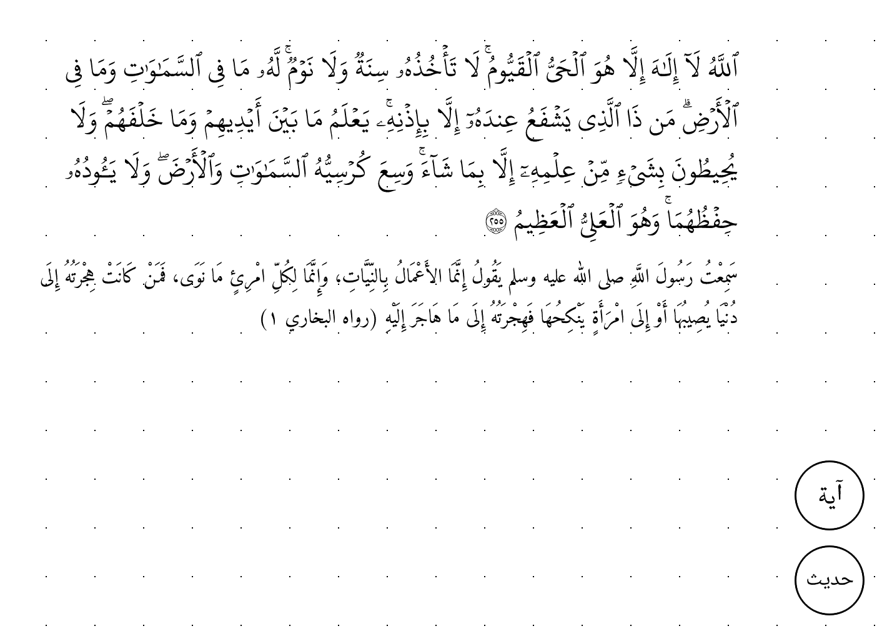
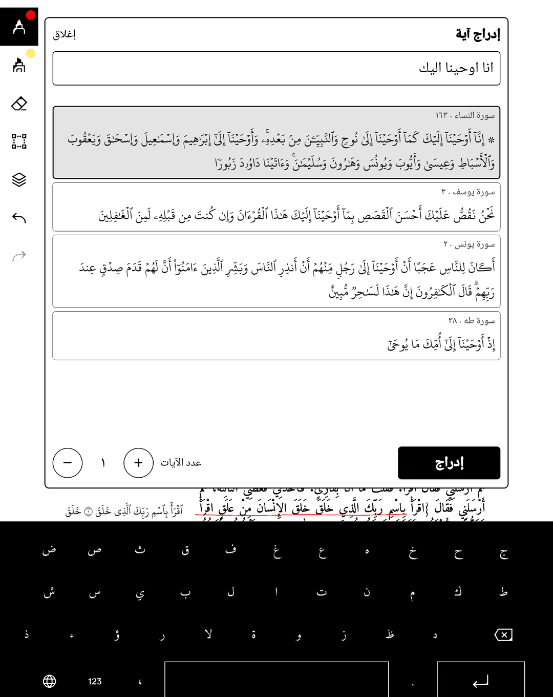
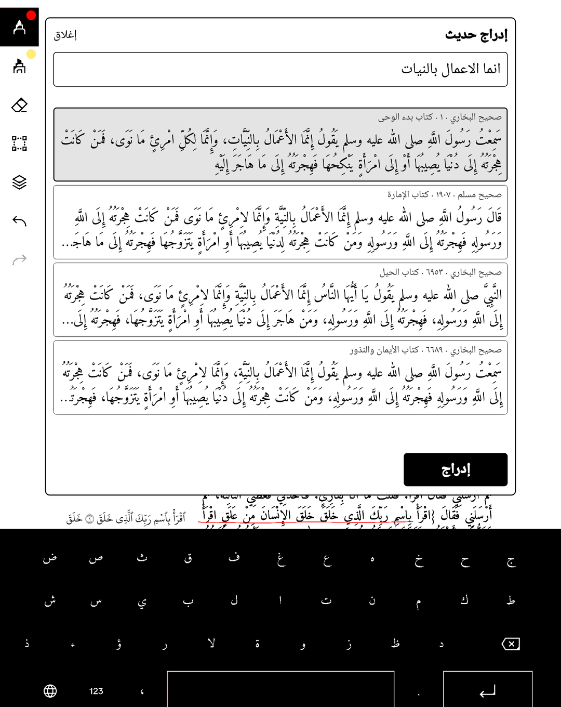

# midad

midad is a collection of extensions for the reMarkable Paper Pro that enables Islamic note-taking. (مداد is the ink scholars write with.) It adds:

- an **Arabic keyboard** layout in the stock on-screen keyboard;
- a **floating search bar** in notes and PDFs: type a few words of an ayah or a hadith the way you remember them (no tashkeel, wrong hamzas, a typo or two), tap the result, and it lands on your page;
- **inserts you can move**: tap one with a finger, then drag it anywhere on the page with a finger or the pen, set its width and size, or remove it, for example into a PDF's margin beside the passage it explains. Your handwriting never moves with it, and the pen writes over it like over the page;
- **Arabic fonts**: the KFGQPC Hafs Quran font for ayat, Amiri for hadith and your own Arabic, so Arabic text stops rendering as boxes.

It covers the whole Quran (6,236 ayat) and Sahih al-Bukhari and Sahih Muslim (about 13,800 matns). Everything runs on the tablet, offline.



| Ayah search: «الحي القيوم» | Hadith search: «انما الاعمال بالنيات» |
|---|---|
|  |  |

## Requirements

- A **reMarkable Paper Pro** (codename Ferrari) on **OS 3.26**. Tested on 3.26.0.68 with xovi 0.3.3 and xovi-extensions 19.
- **xovi** and **qt-resource-rebuilder** already installed and working, for example through [Vellum](https://vellum.delivery) or reManager. Run `/home/root/xovi/rebuild_hashtable` once if you have not.
- On your computer: a **Linux** host with **Nix** (flakes enabled) and **SSH key access as root** to the tablet (`ssh root@10.11.99.1` must work without a password prompt).

The shim in the bundle is compiled for aarch64 by Nix. macOS cannot build it locally; use a Linux machine or a Linux remote builder.

## Install

```sh
nix run .#install                      # root@10.11.99.1 over USB
nix run .#install -- root@192.168.1.50 # another address
```

The installer checks that it is talking to a Paper Pro on OS 3.26 with xovi, uploads the files once, verifies their checksums on the tablet, and swaps each file into place with a rename (never writing a live file in place). Then it restarts xochitl through `guard.sh` and reports the result. Run it again and, if nothing changed, it says "up to date" and leaves xochitl alone.

```sh
nix run .#status                       # read-only: installed? which files differ? is the shim loaded?
nix run .#uninstall                    # removes the addon (your inserts stay), restarts xochitl, checks the shim is gone
nix run .#install -- --dev             # dev variant, see Development
nix run .#install -- --force           # skip the OS version check (other firmware is untested)
```

`nix build` alone produces the bundle (`result/` mirrors what lands under `/home/root`); `nix build .#release` produces `midad-0.1.0-aarch64.tar.gz`, the tarball used by the Vellum recipe. The first build downloads the upstream sources listed below (about 120 MB, mostly the quran-png bundle).

## What is on the tablet

Everything lives under `/home/root`:

```
midad/qml/       AyahBar.qml, search.js, hadith-search.js, layer.js
midad/data/      index.json, quran-hafs-v22.json, surahs.json, hadith.json, hadith-index.json
midad/fonts/     Amiri, Noto Naskh Arabic UI, KFGQPC Hafs v22
midad/fonts.conf, guard.sh, lib/libayahfont.so, licenses/, manifest
xovi/exthome/qt-resource-rebuilder/midad.qmd, midad-kbd.rcc
xovi/services/xochitl.service/midad.conf
.local/share/midad/layer.ini     your inserts (see The midad layer)
```

`manifest` records the version and the sha256 of every file; the installer and `status` compare against it. `layer.ini` is not in it: it holds your inserts, so installing, updating and uninstalling leave it alone.

## How it works

**Keyboard.** xochitl's on-screen keyboard reads its layouts from `:/misc/keyboards/<code>/keyboard_layout.json` inside its Qt resources. `midad-kbd.rcc` carries an `ar_SA` layout there; qt-resource-rebuilder merges it in at startup, and "Arabic" appears in the stock language list. No xochitl code is patched.

**Search bar.** `midad.qmd` is a qt-resource-rebuilder patch for the note editor's scene view. It inserts a single `Loader` that loads `/home/root/midad/qml/AyahBar.qml`, a floating button and panel. The bar searches with `search.js` and `hadith-search.js` (a trigram index with fuzzy matching) over the JSON files in `data/`, and adds the chosen text to the midad layer.

**The midad layer.** Ayat and hadith are not typed into the page. xochitl pins handwriting to a page's typed text (strokes below the text follow its end, strokes over it are anchored to its characters), so moving typed text would drag your handwriting along, or delete strokes anchored to what it removed. Instead the bar draws each insert itself, over the page, and keeps it in `/home/root/.local/share/midad/layer.ini`: one line per document, holding each page's inserts with their text, place, width and size in page units, so they stay put when you zoom or scroll. The file is written through Qt's settings store (a temporary file, then a rename), and the bar checks each write in the file; a notice shows if one fails. A new insert lands near the top of the page in view, below what is already there when there is room, and is selected. Tap an insert with a finger to select it. Selected, it follows a finger or the pen wherever you drag it on the page, the handle on its left edge sets its width (its right edge, where the lines start, stays), − and + step its size, حذف removes it, and تم, tapping elsewhere, turning the page or opening a search panel lets it go. Unselected inserts sit under xochitl's pen surface, so the pen writes over them as over the page, and touches pass through for scrolling and page turns. Inserts work the same on PDF pages, margins included. `layer.js` holds the layer's logic (`bun test test/layer` checks it). What the layer gives up: xochitl does not know about it, so inserts are not in exported PDFs, page thumbnails or the reMarkable cloud, and xochitl's undo does not cover them.

**Fonts.** `midad.conf` is a systemd drop-in that xovi copies into xochitl's service. It points `FONTCONFIG_FILE` at `fonts.conf`, which adds our font directory and makes Amiri the Arabic fallback for the families xochitl uses. That gives every Arabic character a glyph.

**Shim.** Earlier versions of the bar typed inserts into the page, and the shim keeps those in their fonts. xochitl has one font family per paragraph style, so ayat and hadith cannot get different fonts from fontconfig alone. `libayahfont.so` is loaded with `LD_PRELOAD` (after xovi, from the same drop-in) and interposes `QTextCursor::insertText`. Those inserts start with an invisible tag character: U+2061 for an ayah, U+2062 for a hadith. After xochitl inserts a span, the shim looks for the tag (ayat are also recognised by marks only the KFGQPC encoding uses) and sets that span's font family: `kfgqpc_hafs_uthmanic_script` for ayat, `Amiri` for hadith. Sizes and styles stay as xochitl set them. It also keeps the sideways placement those versions gave an insert: six invisible variation selectors after the tag hold the paragraph's right and left margins, and after every insert the shim gives each paragraph it touched those margins (xochitl lays text out with Qt's block margins). The shim does not link Qt, so it loads harmlessly into xochitl's helper processes.

## Sources, fonts and licenses

Nothing derived from these is committed to this repository. The flake fetches each source at a pinned revision, checks its hash, and builds the data on your machine. Full texts and notes are in the bundle's `licenses/` folder.

| What | Source (pinned) | Terms |
|---|---|---|
| Quran text | [nuqayah/qpc-fonts](https://github.com/nuqayah/qpc-fonts) @ `8a4f39d563ea69c994416a1692827e38156c548d`, `text-mushafs/UthmanicHafs_V22/UthmanicHafs v22.json` | KFGQPC's: [terms](http://dm.qurancomplex.gov.sa/copyright-2/); no open licence |
| Quran font `uthmanic_hafs_v22.ttf` | same repo and commit, same folder | KFGQPC terms |
| Search index, surah names | [quran-ws/quran-png](https://github.com/quran-ws/quran-png) release `artwork-v1.0.0`, `quran-svg-hafs-kfgqpc.tar.gz` (sha256 `2bff7bcc…4d17`); only `index/words.json` and `index/surahs.json` are used | Indexes CC BY 4.0; the text and artwork are KFGQPC's and not licensed by it; its LICENSE file is a placeholder |
| Hadith text, chapters | [ShathaTm/LK-Hadith-Corpus](https://github.com/ShathaTm/LK-Hadith-Corpus) @ `c45fa64aa40bf1d4a34b9b35359640a583b02881` | no licence stated upstream |
| Muslim hadith numbers | [fawazahmed0/hadith-api](https://github.com/fawazahmed0/hadith-api) @ `df57907be35291c91ad6a6691180e22ca9920784`, `editions/ara-muslim.min.json` | Unlicense |
| Amiri (Regular, Bold) | [aliftype/amiri](https://github.com/aliftype/amiri) 1.003 | SIL OFL 1.1 |
| Noto Naskh Arabic UI | [notofonts/arabic](https://github.com/notofonts/arabic) | SIL OFL 1.1 |
| Code in this repo | here | **License: not chosen yet** |

Because several of these carry no licence or restrictive terms, do not redistribute a built bundle without checking them. The Qt 6.8.3 headers (nixos-24.11) are used only to compile the shim and are never linked.

## Troubleshooting

- **xochitl does not start after an install.** `guard.sh` waits for xochitl's healthy-start line in the journal (`DeviceReporter enabled`). If it does not appear in time, the guard moves every midad file from `xovi/exthome/qt-resource-rebuilder` and `xovi/services/xochitl.service` into `/home/root/midad-disabled`, kills the hung process and restarts clean. The log is `/tmp/midad-guard.log` on the tablet. `nix run .#status` lists what was parked; fix the cause and run `nix run .#install` again.
- **Back to stock at any time.** On the tablet, `/home/root/xovi/start` restarts xochitl through xovi with whatever is installed; `/home/root/xovi/stock` starts it without xovi; a reboot also returns to stock xochitl. `nix run .#uninstall` removes this addon completely.
- **"<note> closed unexpectedly" after an install or uninstall.** The restart stops xochitl even when a note is open, and xochitl reports it on the next start. Tap Reopen; the note's files are not touched. Close the note before installing to avoid the message.
- **Arabic shows as boxes after uninstalling.** The stock firmware has no Arabic font. The text is still in your notes, and installing again brings the fonts back.
- **The service reboots the tablet after repeated failed starts.** The guard and the uninstaller run `systemctl reset-failed xochitl` before each `xovi/start` for this reason. If you restart by hand a few times in a row, run it yourself first.
- **"hashtab missing".** Run `/home/root/xovi/rebuild_hashtable` on the tablet (needed after an OS update too).
- **"cannot reach … over ssh".** The tools use `ssh -o BatchMode=yes`, so the key must work without a password prompt. Check the cable or Wi-Fi address.
- **Inserts are missing from an exported PDF, a thumbnail or the cloud.** They live in the midad layer on the tablet, not in xochitl's page files (see How it works). Uninstalling keeps `layer.ini`, and installing again shows them again.
- The installer touches only the files it ships, never your documents or your midad layer.

## Install through reManager or Vellum

reManager installs from the Vellum package index, so the route is a Vellum recipe: `packaging/vellum/midad/VELBUILD` (see `packaging/vellum/README.md`). It is not published: the recipe has placeholders for the maintainer and the release URL, a licence has not been chosen, and Vellum's rules require that a person submits it. Once it is in the index, reManager and `vellum add midad` will install the same tree.

## Development

Host tooling is bun/TypeScript or shell. `nix develop` gives bun, the aarch64 cross compiler, `patchelf` and openssh; `$RCC` and `$QT_INCLUDE` point at Qt 6.8's `rcc` and headers.

**Dev variant.** `nix run .#install -- --dev` installs `dev/midad.qmd` instead of the shipped QMD, under the same name so only one bar ever loads. It adds a message-broker block, so it needs the `xovi-message-broker` extension. With it, from the tablet's xovi FIFO: `ayahProbe` (state as JSON), `ayahReload` (reload `AyahBar.qml` from disk without restarting xochitl) and `ayahBench`. `dev/rmhook <signal>` sends one over ssh; `dev/shimtest.sh` launches xochitl once with the shim for testing. The shipped QMD has none of this.

**Checks.**

```sh
nix flake check                 # shellcheck on the busybox scripts that run on the tablet
test/install/run.sh             # installer, uninstaller and status against a fake tablet
MIDAD_TEST_BUSYBOX=1 test/install/run.sh   # same, with a busybox-only PATH on the "tablet" side
bun test                        # search evals and the midad layer
```

`test/install/run.sh` runs the tools against a temp directory with stub `systemctl`, `journalctl` and `pidof`. The `MIDAD_SSH`, `MIDAD_HOME`, `MIDAD_TMP`, `MIDAD_PROC`, `MIDAD_STAGE`, `MIDAD_POLL`, `MIDAD_GUARD_TIMEOUT`, `MIDAD_DTMODEL` and `MIDAD_OSREL` variables exist only for it; leave them unset on real use. It cannot prove xochitl itself behaves; that needs a tablet.

**Build outputs.** `.#data` (search cores and JSON, built by `src/*/build.ts` and checked against known md5s), `.#ayahfont` (the shim, with structural checks that fail the build: AArch64, one exported symbol, NEEDED limited to libgcc_s and libc, no RPATH into the store, no GLOB_DAT/ABS64 relocation against Qt, glibc symbols up to 2.39), `.#keyboard`, `.#bundle`, `.#bundle-dev`, `.#release`.

The rest of this section is the original development notes.

Notes for working on the addon itself (bun/TypeScript only). The design and acceptance criteria are in `ISA.md`.

### Vendor: quran-png

`vendor/quran-png` (gitignored) is a clone of https://github.com/quran-ws/quran-png
at commit **6867ae704debc5b3825e922e9e506254d290f191**. We do not modify it.
Code MIT, data CC BY 4.0, text and artwork under KFGQPC terms (personal use here,
not redistributed).

Setup from a fresh checkout:

```sh
git clone --depth 1 https://github.com/quran-ws/quran-png vendor/quran-png
git -C vendor/quran-png checkout 6867ae704debc5b3825e922e9e506254d290f191
mkdir -p vendor/quran-png/.data
curl -L -o vendor/quran-png/.data/quran-svg-hafs-kfgqpc.tar.gz \
  https://github.com/quran-ws/quran-png/releases/download/artwork-v1.0.0/quran-svg-hafs-kfgqpc.tar.gz
echo "2bff7bcc1d84b61ee9baf2c356ea554b0a1dd317d6a8145406b5cee998914d17  vendor/quran-png/.data/quran-svg-hafs-kfgqpc.tar.gz" | sha256sum -c
tar xzf vendor/quran-png/.data/quran-svg-hafs-kfgqpc.tar.gz -C vendor/quran-png/.data
(cd vendor/quran-png && bun scripts/build-store.mjs)   # ~25 s, writes .data/store + data/index.json
bun install
```

(quran-png's own `package.json` workspaces break `bun install` inside the clone;
dependencies are installed at the project root instead and resolved by walking up.)

### Render

```sh
bun run render 1 1-7 out/fatiha        # PNG (1600 px wide) + SVG, local only
bun run export out/ayat                # all 6236 ayat, SVG + PNG 1200 px wide
```

How quran-png renders: no fonts and no line breaking at request time. The
bundle holds the 604 printed KFGQPC mushaf pages as vector outlines, one
`<g class="word">` per word. `build-store.mjs` cuts them into per-page JSON;
`compose.mjs` picks the printed lines an ayah range touches and places each
word snippet with a translate (mushaf layout keeps printed positions); resvg
rasterises to a transparent PNG. Note single-ayah images use `basmalah=0`.

### Search

```sh
bun run build:search    # dist/search/search.js + dist/search/index.json
bun test
```

Outputs in `dist/search/`: `search.js` (the core, one classic script, ES2017, no host
APIs; loads in QML via `.pragma library`), `index.json` (prebuilt index, ~2.1 MiB),
`text.json` (Uthmani display text per ayah, 1.3 MiB, not part of the index budget).
Usage: `var s = createSearcher(JSON.parse(indexText)); s.search(query, 10)` ->
`[{id, key:"2:255", surah, ayah, to, score, dist, kind:"text"|"ref"}]`.

Corpus: quran-png bundle `index/words.json` (KFGQPC Hafs, 6236 ayat, 77,432 words),
keyed surah:ayah exactly as quran-png numbers them (its `search` field = imla'i
skeleton, `rasm_uthmani` = display/Uthmani skeleton). Both forms are indexed.
Known limit: a query spanning two ayat (e.g. 55:1-2 typed as one phrase) is not matched as a range.

`bun run src/search/bench.ts` prints host latency per query class.

### Engine comparison (quran-search-engine)

`vendor/quran-search-engine` (gitignored) = https://github.com/adelpro/quran-search-engine at
`4de9fd08a00bb18e7c9addc00fd0ad0e031d2fba`, v0.3.2. Both engines run behind `src/search/compare/adapters.ts`
(query in, ranked `surah:ayah` out; its `sura_id`/`aya_id` map 1:1 onto ours, all 6236 ayat).
`bun src/search/compare/run.ts <ours|qse|qse-exact> <acc|lat>`, then `bun src/search/compare/table.ts`.
Same seeded queries as the eval tests (`test/search/queries.ts`); extra root/lemma/phonetic fixture in
`test/search/extras-fixture.ts`, written before either engine ran on it.
